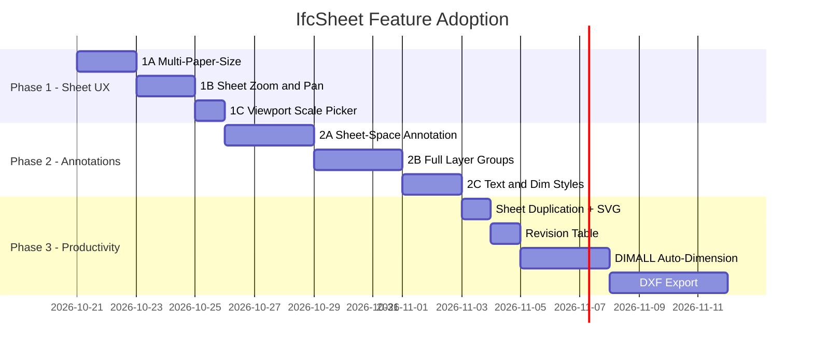

# IfcSheet → BIMWorks: Sheets & Notation Adoption Plan

> [!NOTE]
> **Decisions locked in** (2026-10-20):
> - Paper sizes: **ANSI D, Tabloid, Letter** (not full ISO suite)
> - Sheet annotations: **Backend-persisted** via state bundle
> - Layer system: **Full layer groups** (IfcSheet-style)
> - DXF export: **Phase 3** (PDF sufficient for now)

---

## Gap Analysis: IfcSheet vs BIMWorks Today

| Feature Area | IfcSheet Has | BIMWorks Has | Gap |
|---|---|---|---|
| **Paper Sizes** | A0–A4, both orientations | `ARCH_D` only (hardcoded 1056×704) | 🔴 Critical |
| **Sheet Zoom/Pan** | Wheel zoom about cursor, drag to pan, Fit to bring it back | Fixed-size SVG in a scrollable div | 🔴 Critical |
| **Viewport Scale Picker** | 1:1 to 1:1000, picker on viewport card | Hardcoded `1/4" = 1'-0"` text | 🔴 Critical |
| **Sheet Annotation** | Draw text, leaders, lines, dimensions **directly on the sheet** in paper mm | No sheet-space annotation at all | 🔴 Critical |
| **Layer System** | Layers and layer groups (colour, pen weight, line type, per-view visibility) | No layer system for annotations | 🔴 Critical |
| **Dimension Styles** | Text styles, dimension styles with live preview | Single dimension style, no configurability | 🟡 Moderate |
| **DIMALL** | One-click auto-dimension entire plan | Manual per-pair dimensioning only | 🟡 Moderate |
| **Leaders and Text** | Text and leaders with configurable styles | Text tool exists (TX), no leaders on sheet | 🟡 Moderate |
| **CAD Hatches** | 12 built-in patterns + custom `.pat` file loading | Cut fills exist but limited | 🟡 Moderate |
| **Visibility/Graphics** | Hidden categories, line colours, pen weights per view | Basic lineweight data in sliced2D | 🟡 Moderate |
| **DXF Export** | R2000 DXF with layers, colours, line types | PDF only | 🟡 Phase 3 |
| **Level Marks** | Read from plan/section elevation | Level annotations exist in 2D view | 🟢 Partial |
| **Element Tags** | Tags by GlobalId, auto-update | Tag tool (TG) exists | 🟢 Have It |
| **Grid Axes** | Grid annotation | Grid rendering exists | 🟢 Have It |
| **Door/Window Symbols** | Door swings, window symbols | Door swings and window paths rendered | 🟢 Have It |
| **Sections and Elevations** | Create plans, sections, elevations | SEC and EL tools exist | 🟢 Have It |

---

## Phase 1: Sheet Canvas UX Foundation ← START HERE

> [!IMPORTANT]
> All three items below are contained within [SheetCanvas.tsx](file:///c:/Users/desig/Documents/GitHub/BIMWorks/src/components/sheets/SheetCanvas.tsx) + [bim.ts](file:///c:/Users/desig/Documents/GitHub/BIMWorks/src/types/bim.ts). No backend changes needed.

### 1A. Multi-Paper-Size Support

**Files touched:**
- [bim.ts](file:///c:/Users/desig/Documents/GitHub/BIMWorks/src/types/bim.ts#L258-L267) — extend `SheetDefinition.paperSize` union
- [SheetCanvas.tsx](file:///c:/Users/desig/Documents/GitHub/BIMWorks/src/components/sheets/SheetCanvas.tsx) — dynamic sheet dimensions from lookup
- [useBimStore.ts](file:///c:/Users/desig/Documents/GitHub/BIMWorks/src/store/useBimStore.ts) — `createSheet` default + paper size param

**Paper sizes to add** (per your decision):

| Name | Width (px @72dpi) | Height (px @72dpi) | mm |
|---|---|---|---|
| ANSI_D (current) | 1056 | 704 | 610 × 457 |
| Tabloid / ANSI_B | 792 | 612 | 279 × 432 |
| Letter / ANSI_A | 612 | 792 | 216 × 279 |

**Work:**
- Add `PAPER_SIZES` const lookup
- Replace hardcoded `sheetWidth = 1056` / `sheetHeight = 704` with lookup from `sheet.paperSize`
- Add paper-size dropdown + orientation toggle to the floating control bar
- Scale title block proportionally or use a fixed-width title block column

### 1B. Sheet Zoom and Pan

**Files touched:**
- [SheetCanvas.tsx](file:///c:/Users/desig/Documents/GitHub/BIMWorks/src/components/sheets/SheetCanvas.tsx#L219-L613)

**IfcSheet pattern:** The sheet canvas uses a viewport transform `{tx, ty, scale}`:
- **Wheel** zooms about the cursor position
- **Middle-button drag** (or Shift+drag) pans
- **Fit** resets to show the whole sheet

**Work:**
- Add `viewTransform` state: `{tx: number, ty: number, zoom: number}`
- Wrap all SVG content in `<g transform="translate(tx, ty) scale(zoom)">`
- `onWheel` handler: zoom around cursor (delta → zoom factor, adjust tx/ty to keep cursor point fixed)
- `onPointerDown` + `onPointerMove` for middle-button pan
- "Fit Sheet" button that resets `viewTransform` to center the sheet in the container
- Minimum zoom: 0.1x, maximum zoom: 5x

### 1C. Viewport Scale Picker

**Files touched:**
- [SheetCanvas.tsx](file:///c:/Users/desig/Documents/GitHub/BIMWorks/src/components/sheets/SheetCanvas.tsx#L492-L606) — viewport rendering + action bar
- [bim.ts](file:///c:/Users/desig/Documents/GitHub/BIMWorks/src/types/bim.ts#L248-L256) — `SheetViewport.scaleFactor` already exists

**Standard scales:**
`1:1`, `1:2`, `1:5`, `1:10`, `1:20`, `1:50`, `1:100`, `1:200`, `1:500`, `1:1000`

**Work:**
- Replace the hardcoded `scale(20, -20)` in the viewport `<g>` with `scale(vp.scaleFactor, -vp.scaleFactor)`
- Add a scale dropdown on viewport hover (next to the existing delete button)
- Wire the dropdown to `updateViewportScale(vpId, newScale, sheetId)` store action
- Update the view title bar text from hardcoded `1/4" = 1'-0"` to the actual scale string

---

## Phase 2: Annotation Layer System

### 2A. Sheet-Space Annotation (Backend-Persisted)

**New types:**
```typescript
interface SheetAnnotation {
  id: string;
  kind: 'text' | 'leader' | 'dimension' | 'line';
  layerId: string;
  // Paper-space coordinates (mm from sheet origin)
  points: [number, number][];
  text?: string;
  styleId?: string;
}
```

**Store:** `sheet.annotations: SheetAnnotation[]` — persisted via the existing state bundle.

**Interaction:** When a sheet is active and the user selects TX/DL/DI tool, input events route to sheet-space coordinates (inverse of the viewTransform) instead of model-space.

### 2B. Full Layer Groups

**New types (IfcSheet pattern):**
```typescript
interface DraftingLayer {
  id: string;
  name: string;
  groupId?: string;
  colour: string;
  penWeight: number;   // mm
  lineType: 'solid' | 'dashed' | 'dotted' | 'dashdot';
  visible: boolean;
  locked: boolean;
}

interface LayerGroup {
  id: string;
  name: string;
  layerIds: string[];
}
```

**UI:** Layers panel in the sidebar (or a modal) — toggle visibility, lock, change colour. Group-level switches.

### 2C. Text and Dimension Styles

```typescript
interface TextStyle {
  id: string;
  name: string;
  font: string;
  heightMm: number;   // paper height
  bold: boolean;
  italic: boolean;
  colour: string;
}

interface DimensionStyle {
  id: string;
  name: string;
  arrowType: 'tick' | 'arrow' | 'dot' | 'none';
  textPlacement: 'above' | 'inline' | 'below';
  precision: number;
  gap: number;
  unit: 'mm' | 'm' | 'ft-in';
}
```

---

---

## Phase 3: Productivity (Completed)

| Feature | Status | Notes |
|---|---|---|
| Sheet Duplication | Completed | Full clone with viewports, annotations, revisions via `duplicateSheet` store action |
| SVG Download | Completed | Wires `renderSheetSvgString()` with dynamic title block and annotations |
| Revision Table | Completed | In-title-block clickable table + `RevisionTableModal` with auto-date & sequences |
| DIMALL Auto-Dimension | Completed | `dimAllViewport` action generating aligned facade dimension chains on sheet |
| CAD Hatches | Completed | Architectural SVG patterns (ANSI31, ANSI32, Concrete, Earth, Wood, etc.) via `CADHatchDefs` |
| Viewport Step-Into | Completed | Double-click on viewport switches active view to model space via `setActiveViewId` |
| DXF Export | Completed | AutoCAD R2000 AC1015 ASCII DXF generator with layered linework & download helper |
| Door/Window Schedules | Completed | `SheetScheduleModal` live queries BIM elements with TSV export |

---

## What NOT to Adopt

| Skip | Reason |
|---|---|
| Rust WASM geometry kernel | BIMWorks has its own Python engine |
| IfcSheet's IFC parser | BIMWorks uses `ifcopenshell` |
| IfcSheet's HLR renderer | BIMWorks has mesh-HLR and analytic renderers |
| IfcSheet's `.bvproj` format | BIMWorks has its own backend persistence |

---

## Timeline


